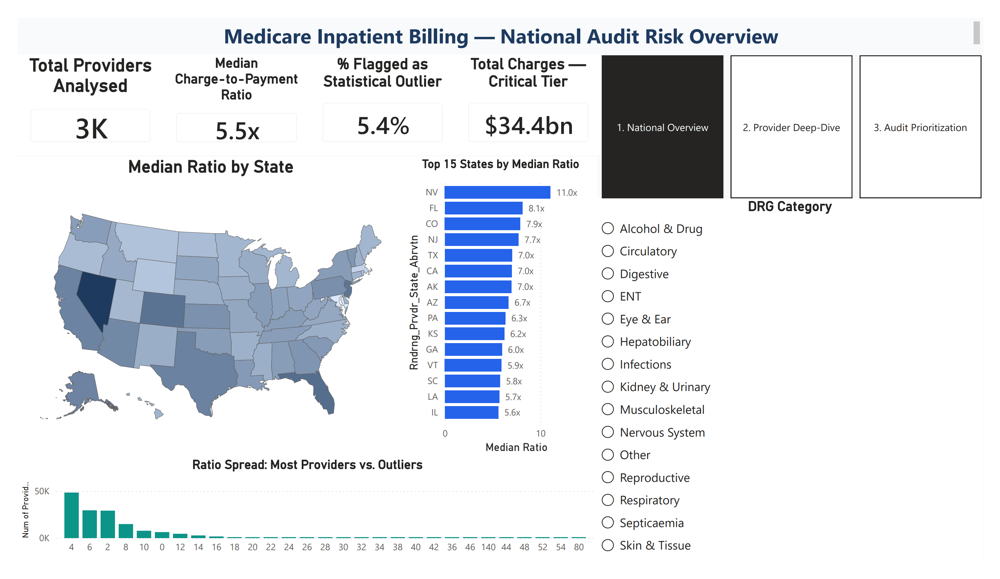

# CMS Medicare Inpatient — Audit Risk Analysis


## Dashboard Preview



---

## Overview

This project analyses Medicare Inpatient Prospective Payment System (IPPS) billing data published by the Centers for Medicare & Medicaid Services (CMS) for fiscal year 2023, covering 146,251 provider-DRG records across 2,937 distinct hospital providers nationwide.

The analysis identifies billing anomalies through charge-to-payment ratio analysis, statistical outlier detection (IQR method), and a three-component composite audit risk scoring model to rank providers by compliance review priority.

Deliverables include a cleaned data pipeline, SQL analysis, a 3-page Power BI dashboard, and a one-page executive summary with financially-grounded audit recommendations.

---

## Key Findings

- The **median charge-to-payment ratio** across all provider-DRG records is **5.52x** — hospitals submit charges at 5.52 times the Medicare reimbursement rate on average, with a maximum of 141.52x observed in a single provider-DRG record.

- **5.36% of records (7,840)** were flagged as statistical outliers using the IQR method. These outlier records account for **$44.8 billion** in submitted charges against only **$2.78 billion** in Medicare payments — an average ratio of 16.1x, nearly 3x the national median.

- **Geographic concentration:** Nevada, Florida, and Colorado rank as the three highest-ratio states nationally. Florida alone accounts for a **$9.07 billion charge-to-payment gap** across outlier providers — the largest financial exposure of any state in the dataset.

- **Procedure-level patterns:** ENT, Eye & Ear, and Alcohol & Drug DRG categories show the highest median ratios nationally, suggesting systemic billing anomalies at the procedure level rather than isolated provider behaviour.

- The composite audit risk scoring model assigned **7,328 records (5.0%) to the Critical tier**, representing **550 distinct hospital providers** that warrant priority compliance review.

---

## Recommendation

Immediate audit review should be prioritised for the 550 Critical-tier providers identified by the scoring model, with Florida as the first state-level focus given its $9.07 billion charge-to-payment gap. At the procedure level, ENT and Eye & Ear DRG categories should be reviewed for possible coding or tariff anomalies, as these categories show the highest median ratios nationally and appear consistently across high-ratio states. A quarterly refresh of this analysis on each new CMS annual data release — requiring no code changes — would enable the compliance team to track ratio trends year-over-year and flag providers whose billing patterns are worsening, not just those currently anomalous.

---

## Technical Approach

**Data source:** CMS Medicare Inpatient Hospitals by Provider and Service (IPPS), DY2023. 146,251 provider-DRG records, 2,937 distinct providers. Source: data.cms.gov (public domain).

**Cleaning pipeline (`01_data_cleaning.ipynb`):**
- Coerced 4 currency columns from `$12,450.00` string format to float
- Zero-padded Provider CCN and ZIP codes to preserve leading zeros
- Standardised hospital name abbreviations and text casing
- Separated identical duplicate rows from same-key-different-value rows
- Flagged logically impossible rows (payment > charge) separately from statistical outliers
- Applied IQR outlier detection with a domain-logic floor at 1.0x

**EDA (`02_eda.ipynb`):** Distribution analysis, state-level comparison, volume vs ratio scatter, DRG category breakdown. All charts saved to `outputs/figures/`.

**SQL analysis (`03_sql_analysis.ipynb`):** 7 queries using DuckDB including window functions (NTILE quartile analysis) and CTEs. Full query file at `sql/cms_analysis_queries.sql`.

**Audit risk scoring (`04_audit_risk_scoring.ipynb`):** Three-component weighted score (ratio 50pts, volume 35pts, outlier flag 15pts). Bin edges derived from actual score percentiles. Final tier distribution: Low 36.6% / Medium 33.7% / High 24.7% / Critical 5.0%.

**Join exercise (`05_broken_merge.ipynb`):** Left join of CMS billing data to HCAHPS Patient Survey on Provider ID. 71 unmatched providers identified and explained — small and specialty facilities below the HCAHPS 100-survey public reporting threshold.

---

## How to Run

**1. Clone the repository**

```bash
git clone https://github.com/kjain0116/cms-medicare-audit-analysis
cd cms-medicare-audit-analysis
```

**2. Install dependencies**

```bash
pip install -r requirements.txt
```

**3. Download the data**

- **CMS IPPS data:** data.cms.gov → search "Medicare Inpatient Hospitals by Provider and Service" → download CSV → save as `data/raw/cms_raw.csv`
- **HCAHPS data:** data.cms.gov/provider-data → search "Patient survey HCAHPS Hospital" → download CSV → save as `data/raw/HCAHPS-Hospital.csv`

**4. Run notebooks in order**

```
notebooks/01_data_cleaning.ipynb
notebooks/02_eda.ipynb
notebooks/03_sql_analysis.ipynb
notebooks/04_audit_risk_scoring.ipynb
notebooks/05_broken_merge.ipynb
```

Each notebook begins with `os.chdir('..')` to set the working directory to the project root — open notebooks from the project root in VS Code for paths to resolve correctly.

**5. Open the dashboard**

Open `dashboard/cms_audit_dashboard.pbix` in Power BI Desktop. If the data connection breaks on your machine, go to **Home → Transform Data → Data source settings** and repoint to `data/processed/cms_audit_scored.csv`.

---

## Project Structure

```
cms-medicare-audit-analysis/
├── README.md
├── requirements.txt
├── data/
│   ├── raw/                          ← not committed (see download instructions above)
│   └── processed/
│       ├── cms_clean.csv             ← output of Notebook 01
│       └── cms_audit_scored.csv      ← output of Notebook 04
├── notebooks/
│   ├── 01_data_cleaning.ipynb
│   ├── 02_eda.ipynb
│   ├── 03_sql_analysis.ipynb
│   ├── 04_audit_risk_scoring.ipynb
│   └── 05_broken_merge.ipynb
├── sql/
│   └── cms_analysis_queries.sql
├── dashboard/
│   └── cms_audit_dashboard.pbix
└── outputs/
    ├── figures/
    │   └── dashboard_overview.png
    └── cms_exec_summary.pdf
```

---

## Skills Demonstrated

| Area | Detail |
|---|---|
| **Data cleaning** | Currency coercion, identifier zero-padding, text standardisation, duplicate detection, logical vs statistical outlier separation |
| **Python** | pandas, numpy, matplotlib, seaborn, duckdb |
| **SQL** | DuckDB, window functions (NTILE), CTEs, CASE WHEN bucketing, aggregation, joins |
| **Power BI** | 3-page report, DAX measures, Power Query M, conditional formatting, custom theme, tooltip pages, slicer sync |
| **Statistical analysis** | IQR outlier detection, percentile-based bin derivation, log normalisation, composite scoring |
| **Business communication** | Executive summary PDF, financially-grounded recommendations, non-technical audience framing |
| **Data joins** | Left join diagnosis, ID format mismatch analysis, unmatched record investigation |

---

## Data Sources

| Dataset | Publisher | Year | Link |
|---|---|---|---|
| Medicare Inpatient Hospitals by Provider and Service | CMS | 2023 | [data.cms.gov](https://data.cms.gov/provider-summary-by-type-of-service/medicare-inpatient-hospitals/medicare-inpatient-hospitals-by-provider-and-service) |
| Patient Survey (HCAHPS) — Hospital | CMS | 2024 | [data.cms.gov/provider-data](https://data.cms.gov/provider-data/dataset/dgck-syfz) |

Both datasets are public domain US government data — free to use in any portfolio.
